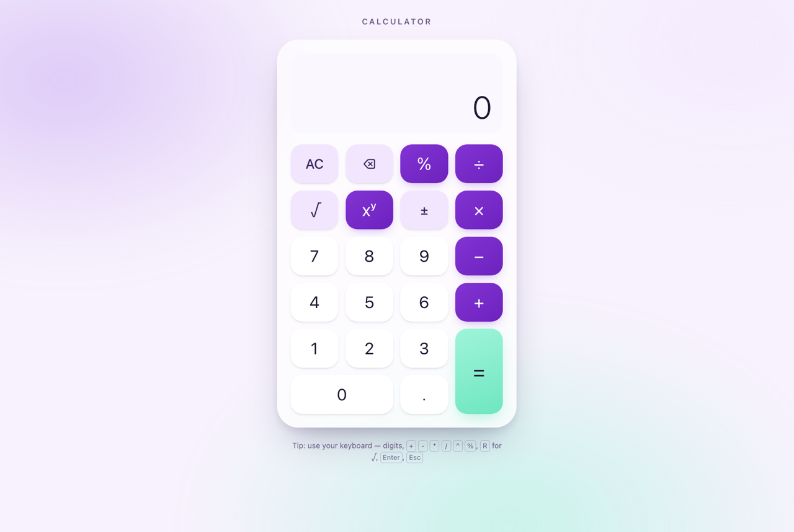

# Calculator

A full-stack calculator: a **React + TypeScript** keypad frontend backed by a **Go** REST service that performs
every calculation. Supports addition, subtraction, multiplication, division, exponentiation, square root and
percentage.



- **Backend:** Go standard library only — no frameworks, no third-party modules.
- **Frontend:** React 19, TypeScript (strict), Vite. Runtime dependencies: `react` and `react-dom` only.
- **Tests:** Go table-driven tests + `httptest`; Vitest + Testing Library. Coverage: backend 89.9%,
  frontend 98.4% of statements (details [below](#testing-and-coverage)).

## Contents

- [Prerequisites](#prerequisites)
- [Quick start](#quick-start)
- [Using the calculator](#using-the-calculator)
- [API](#api)
- [Testing and coverage](#testing-and-coverage)
- [Design decisions and assumptions](#design-decisions-and-assumptions)
- [Project structure](#project-structure)
- [What I would add next](#what-i-would-add-next)
- [AI usage](#ai-usage)

## Prerequisites

| Tool | Version | Needed for |
|---|---|---|
| Go | 1.27.3+ (see `backend/go.mod`) | backend |
| Node.js | 22.12+ (with npm) | frontend |
| GNU Make | any | optional shortcuts |
| Docker | any recent | optional single-container run |

## Quick start

### Run locally (two terminals)

```bash
# Terminal 1 — API on http://localhost:8080
cd backend
go run ./cmd/server

# Terminal 2 — UI on http://localhost:5173
cd frontend
npm ci
npm run dev
```

Open <http://localhost:5173>. The Vite dev server proxies `/api` to `localhost:8080`, so the browser only ever
talks to one origin.

With Make, the same is `make install`, then `make run-backend` and `make run-frontend`. `make help` lists every
target (`test`, `lint`, `coverage`, `build`, `docker`, …).

### Run with Docker (one container)

```bash
docker build -t calculator .
docker run --rm -p 8080:8080 calculator
```

Open <http://localhost:8080>. The image builds the frontend, compiles a static Go binary, and runs it on a
distroless, non-root base; the Go server serves both the UI and the API.

> Docker was not available on the machine this was developed on, so the image was not built locally. The CI
> `docker` job builds it and smoke-tests the running container (health check, UI, one calculation).

### Configuration

The server reads two environment variables:

| Variable | Default | Meaning |
|---|---|---|
| `PORT` | `8080` | Port to listen on |
| `STATIC_DIR` | unset | If set, also serve the built frontend from this directory at `/` |

It logs JSON to stdout and shuts down gracefully on `SIGINT`/`SIGTERM`.

## Using the calculator

It behaves like a pocket calculator: enter a number, an operator, a second number, then `=`. Chained input
such as `2 + 3 × 4 =` evaluates left to right (`5 × 4 = 20`), each step calling the API.

| Key | Keyboard | Notes |
|---|---|---|
| `0`–`9`, `.` | digits, `.` or `,` | up to 15 digits per entry |
| `+` `−` `×` `÷` | `+` `-` `*` (or `x`) `/` | |
| `xʸ` | `^` | power |
| `%` | `%` | binary: `15 % 200 =` → 30 (15 % of 200) |
| `√` | `R` | applies to the current entry; `9 + √16 =` → 13 |
| `±` | `N` | toggle sign |
| `=` | `Enter` or `=` | |
| `⌫` / `AC` | `Backspace` / `Esc` or `Delete` | |

Results are rounded to 12 significant digits for display (so `0.1 + 0.2` shows `0.3`) and switch to scientific
notation when they would not fit or when rounding would change the integer part. Errors from the API (for
example dividing by zero) are shown in the display; the next digit starts over.

## API

Base URL: `http://localhost:8080`. All responses are JSON, including errors, 404 and 405.

### `POST /api/v1/calculate`

Request body (`Content-Type: application/json` is required):

| Field | Type | Required |
|---|---|---|
| `operation` | string | yes — one of the operations below |
| `a` | number | yes |
| `b` | number | for every operation except `sqrt`, which must not have it |

| `operation` | Result |
|---|---|
| `add` | a + b |
| `subtract` | a − b |
| `multiply` | a × b |
| `divide` | a ÷ b |
| `power` | aᵇ |
| `sqrt` | √a |
| `percent` | a % of b, i.e. a × b ÷ 100 |

Success (`200 OK`) echoes the input with the result:

```bash
curl -s localhost:8080/api/v1/calculate \
  -H 'Content-Type: application/json' \
  -d '{"operation":"divide","a":10,"b":4}'
```

```json
{"operation":"divide","a":10,"b":4,"result":2.5}
```

```bash
curl -s localhost:8080/api/v1/calculate -H 'Content-Type: application/json' -d '{"operation":"sqrt","a":16}'
# {"operation":"sqrt","a":16,"result":4}

curl -s localhost:8080/api/v1/calculate -H 'Content-Type: application/json' -d '{"operation":"percent","a":15,"b":200}'
# {"operation":"percent","a":15,"b":200,"result":30}

curl -s localhost:8080/api/v1/calculate -H 'Content-Type: application/json' -d '{"operation":"power","a":2,"b":10}'
# {"operation":"power","a":2,"b":10,"result":1024}
```

### Errors

Every error has the same shape, with a stable machine-readable `code` and a human-readable `message`:

```json
{"error":{"code":"division_by_zero","message":"cannot divide by zero"}}
```

| Status | `code` | When |
|---|---|---|
| 400 | `invalid_request` | Malformed JSON, wrong type, unknown field, body over 1 KB, more than one JSON value |
| 400 | `unknown_operation` | `operation` missing or not in the table above |
| 400 | `missing_operand` | `a` missing, or `b` missing for a binary operation |
| 400 | `unexpected_operand` | `b` sent for `sqrt` |
| 404 | `not_found` | Unknown path |
| 405 | `method_not_allowed` | Wrong method (with an `Allow` header) |
| 415 | `unsupported_media_type` | `Content-Type` is not `application/json` |
| 422 | `division_by_zero` | `b` is 0 for `divide`, or 0 raised to a negative power |
| 422 | `invalid_domain` | Square root of a negative number |
| 422 | `result_out_of_range` | Result overflows float64, or is not a real number (e.g. `(-8) ^ 0.5`) |

Examples (real output):

```bash
curl -s -w 'HTTP %{http_code}\n' localhost:8080/api/v1/calculate -H 'Content-Type: application/json' -d '{"operation":"divide","a":1,"b":0}'
# {"error":{"code":"division_by_zero","message":"cannot divide by zero"}}
# HTTP 422

curl -s -w 'HTTP %{http_code}\n' localhost:8080/api/v1/calculate -H 'Content-Type: application/json' -d '{"operation":"sqrt","a":-4}'
# {"error":{"code":"invalid_domain","message":"cannot take the square root of a negative number"}}
# HTTP 422

curl -s -w 'HTTP %{http_code}\n' localhost:8080/api/v1/calculate -H 'Content-Type: application/json' -d '{"operation":"multiply","a":1e308,"b":10}'
# {"error":{"code":"result_out_of_range","message":"result is out of range"}}
# HTTP 422

curl -s -w 'HTTP %{http_code}\n' localhost:8080/api/v1/calculate -H 'Content-Type: application/json' -d '{"operation":"add","a":"2","b":3}'
# {"error":{"code":"invalid_request","message":"field \"a\" must be a number"}}
# HTTP 400

curl -s -w 'HTTP %{http_code}\n' localhost:8080/api/v1/calculate -H 'Content-Type: application/json' -d '{"operation":"subtract","a":5}'
# {"error":{"code":"missing_operand","message":"operation \"subtract\" requires field \"b\""}}
# HTTP 400

curl -s -w 'HTTP %{http_code}\n' localhost:8080/api/v1/calculate -H 'Content-Type: application/json' -d '{"operation":"modulo","a":5,"b":2}'
# {"error":{"code":"unknown_operation","message":"unknown operation \"modulo\""}}
# HTTP 400

curl -s -w 'HTTP %{http_code}\n' localhost:8080/api/v1/calculate -d '{"operation":"add","a":1,"b":2}'
# {"error":{"code":"unsupported_media_type","message":"Content-Type must be \"application/json\""}}
# HTTP 415
```

### `GET /healthz`

```bash
curl -s localhost:8080/healthz
# {"status":"ok"}
```

## Testing and coverage

```bash
make test       # go test -race ./... and vitest
make lint       # gofmt, go vet, oxlint, tsc
make coverage   # writes backend/coverage.html and frontend/coverage/index.html
```

Or per layer: `cd backend && go test -race -cover ./...` and `cd frontend && npm run coverage`.

Coverage at the time of writing:

| Layer | Package / scope | Statements |
|---|---|---|
| Backend | `internal/calculator` | 100% |
| Backend | `internal/api` | 95.8% |
| Backend | `cmd/server` | 75.5% (the untested remainder is mostly `main()` itself) |
| Backend | **total** | **89.9%** |
| Frontend | all of `src/` (111 tests) | **98.4%** statements, 95.2% branches, 100% lines |

What is tested:

- **Calculator domain** — every operation, arity errors, division by zero, `0` to a negative power, negative
  square roots, overflow and NaN, very large and very small values.
- **HTTP handler** — success per operation, every error code, malformed/oversized/trailing bodies, wrong types,
  unknown fields, content types, 404/405 bodies and `Allow` headers.
- **Server** — starts on a free port, serves the API, serves static files without directory listings, shuts
  down gracefully, fails fast on a busy port.
- **Frontend** — the keypad state machine (a pure reducer), number formatting, input parsing, the API client
  (success, API errors, malformed responses, network failure, aborts), and the component through the keypad
  and the keyboard with a mocked API.

CI (`.github/workflows/ci.yml`) runs all of the above on every push and pull request, uploads both coverage
reports as artifacts, and builds and smoke-tests the Docker image.

## Design decisions and assumptions

**One endpoint with an `operation` field** rather than one endpoint per operation. The operations share the
same shape, validation and error handling, so a single table-driven path is less code and adding an operation
is one `case`. The path is versioned (`/api/v1`) so the contract can change without breaking clients.

**400 vs 422.** 400 means the request itself is wrong (bad JSON, unknown operation, missing operand). 422 means
the request is well formed but the maths is undefined (divide by zero, √ of a negative, overflow). A client can
tell "my code has a bug" apart from "the user asked for something impossible", and the `code` field is the
stable contract; messages are for humans.

**Strict input handling.** Bodies are capped at 1 KB, unknown fields and trailing data are rejected, and
`Content-Type` must be JSON. A typo such as `"B": 4` fails loudly instead of being silently ignored. Duplicate
keys follow `encoding/json` (the last one wins).

**The domain package knows nothing about HTTP.** `internal/calculator` is pure functions with sentinel errors;
`internal/api` decodes, validates the shape and maps errors to status codes. The optional second operand is a
`*float64` in the domain, which mirrors the API's "absent vs zero" distinction directly; separate unary and
binary functions would be the alternative if the operation set grew.

**float64 everywhere.** Both Go and JavaScript use IEEE-754 doubles, so values round-trip through JSON without
loss. The API returns the exact double (`0.1 + 0.2` → `0.30000000000000004`); the UI rounds to 12 significant
digits for display. A decimal library would only be justified for money, which this is not. Non-finite results
are errors because JSON cannot represent `Inf` or `NaN`.

**Percent is binary: `a % of b`.** `15 % 200` is 30. Pocket calculators overload `%` contextually
(`200 + 15 %` → 230), which is ambiguous to specify as an API; the explicit form is documented and
predictable.

**The backend does all arithmetic.** The UI is a keypad, so it needs a small state machine (current entry,
pending operator, chaining), but it never computes a result itself. That logic lives in a pure reducer
(`calculatorState.ts`) that is unit-tested without React. The UI checks input *shape* for immediate feedback;
the backend is authoritative for every rule, because any client can call it.

**No CORS.** In development Vite proxies `/api` to the Go server; in Docker the Go server serves the built UI
itself. The browser only ever sees one origin, so there is no CORS configuration to get wrong.

**Standard library only in Go.** Go's `ServeMux` supports method and path patterns, and `log/slog` gives
structured logging, so a router or logging library would add nothing here.

**Production basics, kept small.** Server read/write/idle timeouts, graceful shutdown, JSON logs, a health
endpoint, a distroless non-root image. Only 5xx responses are logged as errors; client errors are expected.

**Frontend tooling.** Vite's React template, with its default linter (oxlint) plus TypeScript in strict mode.
jsdom is pinned to v29 because later versions require a newer Node 22 minor than the one the project was
developed on.

**Accessibility and responsiveness.** Keys are real buttons with accessible names, operators expose
`aria-pressed`, results are announced through a live region, and everything works from the keyboard. The layout
fits any window size by scaling with the viewport, goes full screen on phones and tablets, and respects
`prefers-reduced-motion` and dark mode.

**Out of scope on purpose:** persistence, history, authentication, rate limiting, expression parsing
(`2+3*4` with precedence), and browser end-to-end tests.

## Project structure

```
.
├── backend/
│   ├── cmd/server/            # entrypoint: env config, timeouts, static files, graceful shutdown
│   └── internal/
│       ├── calculator/        # pure domain logic and sentinel errors
│       └── api/               # HTTP handler: decoding, validation, error mapping
├── frontend/
│   └── src/
│       ├── components/        # Calculator keypad component
│       ├── calculatorState.ts # keypad state machine (pure reducer)
│       ├── api.ts             # typed API client and ApiError
│       ├── format.ts          # number and expression formatting
│       ├── validation.ts      # operand parsing
│       └── operations.ts      # operation names and labels
├── docs/                      # phased implementation plan used to build this
├── .github/workflows/ci.yml   # lint, test, coverage, build, Docker smoke test
├── Dockerfile                 # node build → go build → distroless runtime
├── Makefile
└── PROMPTS.md                 # prompts used with the AI assistant
```

## What I would add next

- An OpenAPI description of the API, and contract tests generated from it.
- A Playwright end-to-end test running against the Docker image in CI.
- Rate limiting and request IDs in the logs if the service were exposed publicly.
- A calculation history panel (client-side only — the service should stay stateless).

## AI usage

This was built with Claude Code as a pair programmer: planning, implementation, review, and refactoring. Every
change was reviewed, tested and adjusted by me. [`PROMPTS.md`](PROMPTS.md) lists the prompts used, in order, with
notes on what I accepted, changed or rejected. The phased plan the work followed is in [`docs/`](docs/README.md).
